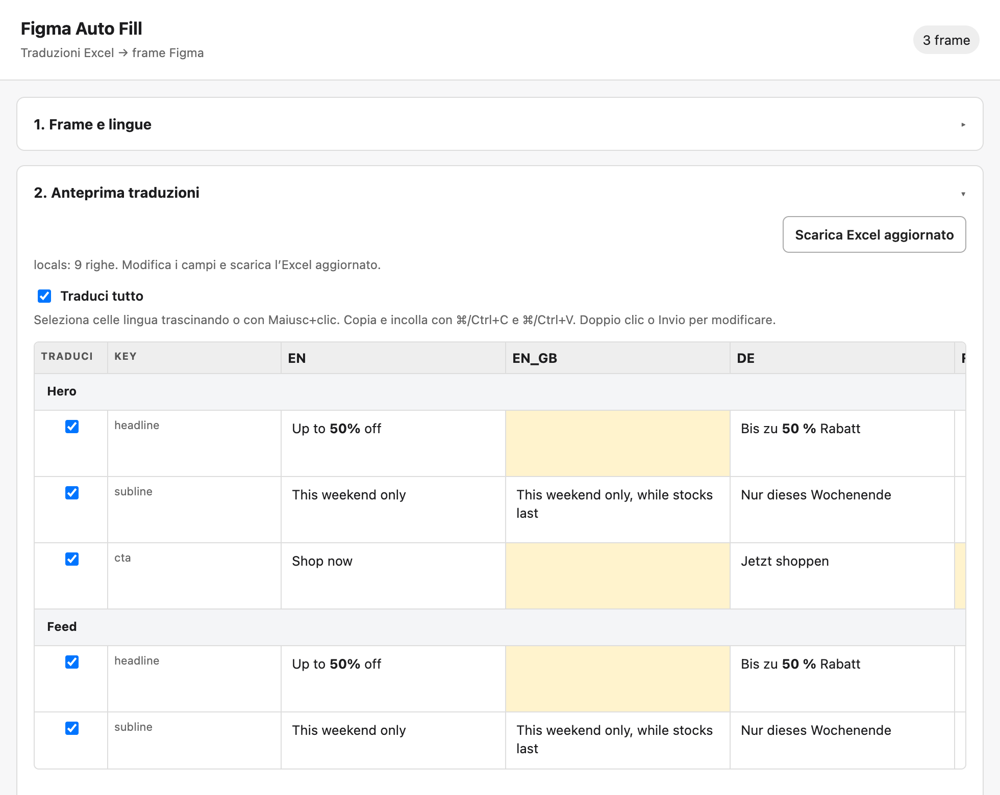
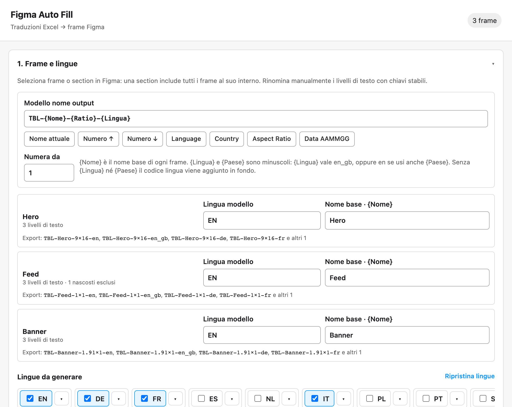
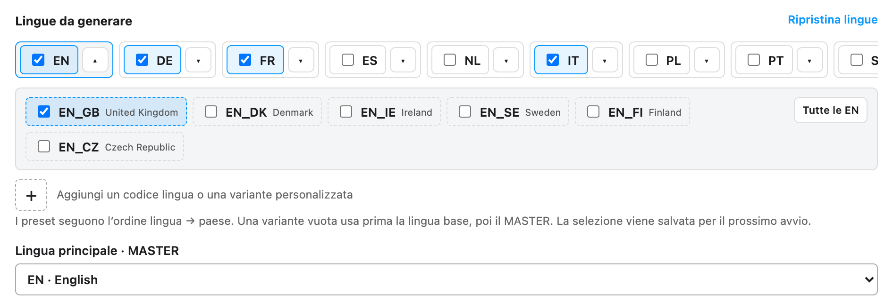
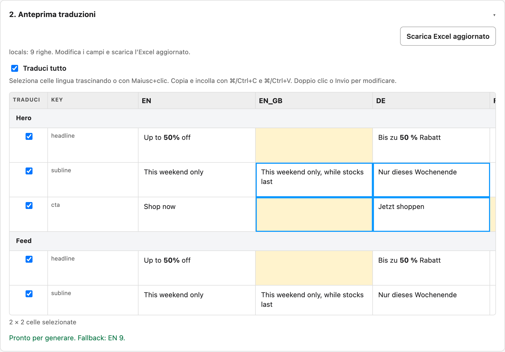
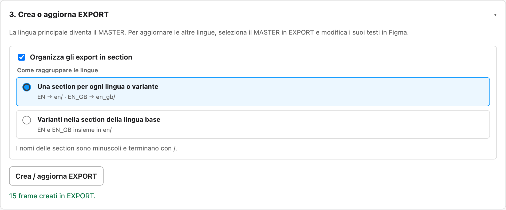
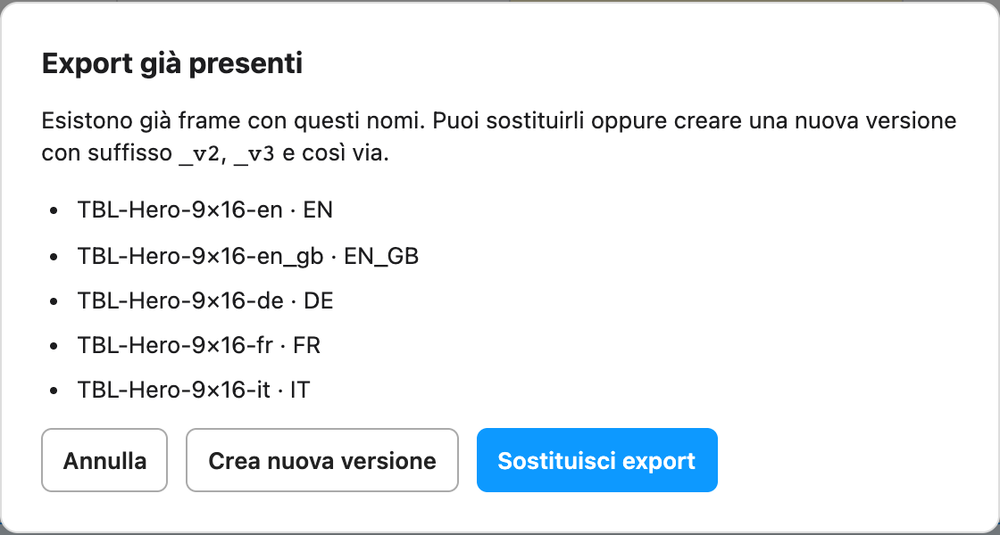

# Figma Auto Fill

Plugin per Figma Design che crea le varianti linguistiche di uno o più frame a partire da una tabella di traduzioni, compilata nel plugin o in Excel, e le raccoglie nella pagina `EXPORT` con la formattazione del modello. Il frame sorgente resta intatto. In modo facoltativo un agente AI può guidare il lavoro a partire da un Excel cliente. Nell'uso manuale l'Excel viene letto dentro il plugin e non viene inviato in rete.



*Tutti gli screenshot mostrano l'interfaccia del plugin con dati dimostrativi di una campagna fittizia.*

| [Installazione](#installazione) | [Funzionalità](#funzionalità) | [Come si usa](#come-si-usa) | [Modalità agente](#modalità-agente-mcp) | [Formattazione e limiti](#formattazione-e-limiti) | [Sviluppo](#sviluppo) |
| :---: | :---: | :---: | :---: | :---: | :---: |

## Installazione

### Per i designer (senza Node.js)

Non serve installare Node.js né usare il terminale. Dalla pagina **[Releases](https://github.com/GaetanoBonaccioPlay/figma-auto-fill/releases/latest)** del repository (sempre l'ultima versione; le precedenti sono nell'[elenco completo](https://github.com/GaetanoBonaccioPlay/figma-auto-fill/releases)) si scaricano due file, nella sezione **Assets** in fondo alla release; il secondo serve solo per la [modalità agente](#modalità-agente-mcp).

| File | A cosa serve |
| --- | --- |
| `figma-auto-fill-plugin-vX.Y.Z.zip` | Il plugin per Figma Desktop |
| `figma-auto-fill-vX.Y.Z.mcpb` | Il server per Claude Desktop (macOS), con tutto incorporato |

**Plugin**

1. Scompatta lo zip in una cartella che non sposterai (per esempio in Documenti): Figma la rilegge a ogni apertura.
2. In Figma Desktop: **Plugins → Development → Import plugin from manifest…** e scegli `manifest.json` della cartella.
3. Avvia **Figma Auto Fill** da **Plugins → Development**.

**Modalità agente con Claude Desktop** (facoltativa)

1. Fai doppio clic su `figma-auto-fill-vX.Y.Z.mcpb` e conferma l'installazione in Claude Desktop.
2. Apri il plugin in Figma: nell'intestazione compare **Agente collegato**. Poi in Claude Desktop chiedi di localizzare i frame selezionati e indica l'Excel.

**Aggiornare:** scarica la nuova release, sostituisci la cartella del plugin con quella nuova e fai di nuovo doppio clic sul file `.mcpb`.

### Da sorgente (per sviluppare)

1. Installa Node.js 20 o successivo e apri Figma Desktop.
2. In questa cartella esegui `npm install` e `npm run build`.
3. In un file Figma Design modificabile, apri **Plugins → Development → Import plugin from manifest…** e scegli `manifest.json` di questa cartella.
4. Avvia **Figma Auto Fill** dal menu Development.

Dopo modifiche al codice, esegui di nuovo `npm run build` e riavvia il plugin. Il plugin non importa file `.fig` direttamente: lavora sul documento aperto in Figma.

## Funzionalità

- **Più frame insieme:** seleziona frame o section e lavora su tutti in un unico foglio.
- **Nomi di output a modello:** variabili per nome, numerazione, lingua, paese, aspect ratio e data.
- **Lingue e varianti di paese:** 11 lingue pronte con i relativi paesi, più codici ISO personalizzati.
- **Foglio di traduzione integrato:** selezione di intervalli, copia e incolla da altri fogli, modifica nella cella.
- **Import ed export `.xlsx`:** puoi tradurre nel plugin, in Excel o alternando i due.
- **Fallback controllati:** una cella vuota eredita il testo da una lingua definita e viene evidenziata.
- **Grassetto, corsivo, sottolineato e barrato:** tag `<b>`, `<i>`, `<u>`, `<s>` nelle celle, conservati anche dall'incolla HTML.
- **Organizzazione in section:** export raggruppati per lingua o per lingua base.
- **MASTER e versioni:** riapri una serie già generata, sostituiscila o crea una nuova versione `_v2`, `_v3`.
- **Preferenze salvate:** lingue, modello del nome e ordine delle colonne restano tra un avvio e l'altro.

### Selezione e nomi di output



Il **Modello nome output** vale per tutti i frame selezionati e funziona come **Rename…** di Figma: i pulsanti inseriscono la variabile nel punto del cursore. Con `TBL-{Nome}-{Ratio}-{Lingua}` si ottiene per esempio `TBL-Hero-9x16-en`.

| Pulsante | Variabile | Valore |
| --- | --- | --- |
| Nome attuale | `{Nome}` | Nome base del frame, modificabile nella sua scheda |
| Numero ↑ / Numero ↓ | `{N↑}` / `{N↓}` | Numerazione crescente o decrescente nell'ordine dei frame, a partire da **Numera da** |
| Language | `{Lingua}` | Codice completo (`en_gb`); solo la lingua (`en`) se il modello usa anche `{Paese}` |
| Country | `{Paese}` | Paese (`gb`); vuoto per EN, e in quel caso il separatore che lo precede viene rimosso |
| Aspect Ratio | `{Ratio}` | Aspect ratio del frame ridotto ai minimi termini, per esempio `1x1` (1200×1200), `4x5` (1080×1350), `9x16`; se la proporzione non si riduce a numeri interi corti restano i pixel del frame (`1200x628`) |
| Data AAMMGG | `{Data}` | Data di oggi; un prefisso data già presente nel nome viene sostituito |

- `{Lingua}` e `{Paese}` sono sempre minuscoli. Se il modello non contiene nessuna delle due, il codice lingua viene aggiunto in fondo (`_EN`).
- Le nuove versioni aggiungono `_v2`, `_v3` al valore di `{Nome}`.
- Ogni scheda frame mostra l'anteprima dei nomi, e due export con lo stesso nome bloccano la generazione.
- I frame selezionati possono avere lo stesso nome: nell'anteprima e nella colonna `Frame` dell'Excel compaiono come `Nome (1)`, `Nome (2)` nell'ordine dei layer. Basta che il modello li distingua, per esempio con `{N↑}` o `{Ratio}`.
- Modello e numero iniziale vengono salvati per i prossimi avvii.

### Lingue e varianti



Le schede sono affiancate nell'ordine English, German, French, Spanish, Dutch, Italian, Polish, Portuguese, Swedish (`SV`), Danish (`DA`), Czech (`CS`). Aprine una per vedere i paesi e il pulsante **Tutte le EN/DE/…**.

- Al primo avvio è selezionata solo EN, che è anche la lingua modello iniziale.
- Il pulsante `+` aggiunge codici personalizzati come `EN_GB`; **Ripristina lingue** torna alla selezione iniziale.
- Selezione, lingua principale e codici personalizzati sono conservati tra i riavvii.
- Sono accettati codici di lingua ISO 639-1 e, nelle varianti, codici paese ISO 3166-1. Un suffisso come `_nm` resta parte del nome del frame.

### Anteprima e modifica delle traduzioni



**Genera locales** crea un unico foglio con intestazioni fisse (`Traduci`, `Key` e lingue) e una riga di separazione per ogni frame, nello stesso ordine dall'alto verso il basso dei layer Figma. Le celle gialle sono quelle che useranno un fallback.

- Attiva le righe una per una oppure con **Traduci tutto**. Ripremendo **Genera locales** le correzioni compatibili già inserite restano.
- Seleziona più celle trascinando o con Maiusc+clic. Con ⌘/Ctrl+C e ⌘/Ctrl+V copi e incolli intervalli da un altro foglio: tabulazioni e ritorni a capo separano colonne e righe.
- Se gli appunti contengono HTML riconoscibile, l'incolla conserva grassetto, corsivo, sottolineato e barrato.
- Doppio clic, Invio o F2 aprono la modifica della cella. Le colonne `Traduci` e `Key` non fanno parte dell'intervallo copiabile.
- Trascina l'intestazione di una colonna lingua per spostarla. Il nuovo ordine vale anche per l'Excel scaricato e viene salvato, anche per le lingue al momento non selezionate.
- La colonna `Key` è compatta: se un nome è troncato, passa il puntatore sulla cella per leggerlo per intero.

### Excel

Dopo aver generato i locals puoi scaricare il template `.xlsx`, oppure importare un file esistente. Il foglio `Translations` contiene `Frame`, `Key`, `Traduci` e una colonna per lingua. L'Excel aggiornato si scarica dall'anteprima con **Scarica Excel aggiornato**.

### Fallback

Una cella vuota in una variante usa prima la sua lingua base (`EN_GB` → `EN`) e, se anche quella è vuota, la lingua principale scelta nel plugin. Le lingue senza paese passano direttamente alla lingua principale.

La colonna della lingua base viene aggiunta automaticamente ai locals e all'Excel. Il plugin evidenzia il fallback effettivo nell'anteprima e lo segnala al termine. Se non trova alcun testo, blocca la generazione.

### Creazione degli export



I frame creati sono modificabili e si trovano nella pagina `EXPORT`. Le colonne delle lingue sono allineate e distanziate in base al frame più largo.

Con **Organizza gli export in section** scegli tra **una section per ogni lingua o variante** (`en/`, `en_gb/`) e **varianti nella section della lingua base** (`en/` contiene EN ed EN_GB). Le section hanno nomi minuscoli con `/` finale, vengono riutilizzate nelle generazioni successive e si allargano per contenere le varianti aggiunte.

### MASTER, sostituzione e versioni



Il frame della lingua principale in `EXPORT` è marcato come **MASTER**. Per rieditare una serie già generata, seleziona il frame sorgente oppure modifica e seleziona il MASTER in Figma, poi premi **Genera locales**.

- Dal sorgente l'anteprima recupera i testi dell'ultima versione esportata; dal MASTER quelli delle varianti collegate al suo gruppo. La ricerca comprende i frame dentro le section.
- Le righe con testi tradotti vengono attivate, e le correzioni non vuote già fatte nell'anteprima restano prioritarie.
- Se esistono già export creati dal plugin con gli stessi nomi, anche dentro una section, un dialogo permette di sostituirli oppure di creare una nuova versione. Il suffisso `_v2`, `_v3` è lo stesso per tutte le lingue del gruppo, e il gruppo precedente viene conservato.
- Se attivi le section su un export precedente, il MASTER viene spostato nella section appropriata.
- Quando il modello selezionato è un MASTER, i testi della lingua principale nell'anteprima sono di sola lettura.

## Come si usa

Le tre sezioni numerate del plugin seguono il flusso di lavoro e si aprono e chiudono facendo clic sul titolo.

1. **Frame e lingue.** Seleziona uno o più frame o section in Figma; una section include i frame al suo interno nell'ordine dei layer, comprese le section dei MASTER in `EXPORT`. Scegli il modello del nome e le lingue, poi premi **Genera locales**.
2. **Anteprima traduzioni.** Attiva le righe e inserisci o correggi i testi, oppure lavora in Excel e reimporta il file.
3. **Crea o aggiorna EXPORT.** Se vuoi, attiva le section, poi premi **Crea / aggiorna EXPORT**.

Prima di iniziare, dai nomi univoci ai livelli di testo da tradurre, per esempio `headline` e `cta`: diventano le chiavi del foglio.

- I livelli di testo nascosti, o dentro un gruppo o frame nascosto, non compaiono tra i campi da tradurre e restano invariati negli export.
- Se più livelli visibili hanno lo stesso nome, il plugin li numera in ordine (`headline_1`, `headline_2`, …) senza rinominarli in Figma e mostra un avviso sotto l'anteprima.

## Modalità agente (MCP)

Un agente AI (per esempio Claude Code) può guidare tutto il flusso partendo da un **Excel cliente** con struttura libera: analizza l'Excel, riconosce il Brand a cui somiglia (senza imporlo), abbina i testi dei frame alle righe, fa confermare le lingue che servono a quelle righe, fa generare gli export dal plugin e scrive un **Excel aggiornato** con i testi usati in Figma. Il plugin resta l'unico a modificare Figma ([ADR 0001](docs/adr/0001-mcp-bridge-localhost-verso-plugin.md)); termini come *Profilo brand* e *Abbinamento* sono definiti in [CONTEXT.md](CONTEXT.md).

### Configurazione

Con Claude Desktop basta il file `.mcpb` descritto in [Installazione per i designer](#per-i-designer-senza-nodejs). I passi seguenti servono per lavorare da sorgente, per esempio con Claude Code.

1. Esegui `npm install` e `npm run build`.
2. Registra il server nel client MCP, per esempio con Claude Code:
   ```
   claude mcp add figma-auto-fill -- node /percorso/assoluto/figma-auto-fill/dist/server/index.mjs
   ```
3. Apri il plugin in Figma Desktop: nell'intestazione compare **Agente collegato** quando il server è raggiungibile. Se il server riparte, il plugin si ricollega da solo. Il collegamento è su `ws://localhost:3055`; con la variabile `FIGMA_AUTOFILL_PORT` puoi cambiare la porta del server, ma il plugin usa sempre la 3055.

   Ogni sessione Claude (Claude Desktop, Claude Code, VS Code) avvia il proprio server, ma la porta è una sola. Chi la trova occupata resta in attesa e la prende da solo quando si libera. Se ricevi una richiesta mentre la porta è di un'altra sessione, il server se la fa cedere e il plugin si ricollega in circa 2 secondi; la cessione non avviene mai a metà di un comando. Le sessioni si riconoscono con un segreto in `~/.figma-auto-fill/bridge-secret`, creato al primo avvio e leggibile solo da te. Se `bridge_status` dice che la porta è occupata da un processo che non la cede, è un server di una versione precedente o un altro programma: trovalo con `lsof -i :3055`.
4. Avvia il prompt MCP **`localizza-frame`** (parte subito, senza moduli: l'agente ti chiede l'Excel nel dialogo) oppure descrivi il lavoro all'agente.

Il server tiene un solo plugin per volta: se il plugin è aperto in due file Figma resta collegato il primo, e il secondo mostra **Agente in uso da un altro plugin** finché non chiudi il primo.

Il collegamento vale solo per il plugin importato da manifest (modalità sviluppo). Per distribuire il plugin con la modalità agente serve una decisione separata sull'accesso a `localhost`.

### Il dialogo

| Passo | Cosa succede | Strumenti |
| --- | --- | --- |
| 1. Traduzioni | L'Excel sul Mac è facoltativo. **Testi in chat o file allegato** (Excel, CSV, PDF, Word…): l'agente li legge e li passa direttamente al plugin come tabella, senza cercare file sul Mac; in questo caso non c'è Excel aggiornato. **Excel sul Mac**: individua foglio, intestazione e colonne lingua (anche `Italiano`, `Deutsch`, `FR-fr`) e tu confermi la mappatura; se indichi solo il nome del file lo cerca in Download, Scrivania e Documenti. L'analisi lavora su una copia temporanea in `excel-clienti/temp-<pid>/` (accanto al server, o in `FIGMA_AUTOFILL_EXCEL_DIR`), eliminata a fine sessione: l'originale non si tocca e `_updated.xlsx` viene scritto accanto all'originale | `load_translations`, `analyze_client_excel` |
| 2. Brand (facoltativo) | Confronta il **Modello Excel** con quelli dei profili e propone il Brand a cui somiglia, chiedendo conferma. Con più candidati ti fa scegliere; se nel plugin hai selezionato un altro profilo te lo fa notare e chiede quale usare; se l'Excel è nuovo si lavora senza Brand. Le differenze con il profilo sono solo informative: vale l'Excel | `analyze_client_excel`, `get_brand_profile`, `clear_brand`, `list_brand_profiles` |
| 3. Selezione | Legge i frame selezionati e i livelli di testo visibili | `bridge_status`, `get_selection` |
| 4. Abbinamento | La **Colonna sorgente** si sceglie dai dati: è quella i cui testi coincidono con i livelli Figma, anche se il profilo dice un'altra lingua (te lo segnala). Testi identici (ignorando spazi, maiuscole, punteggiatura finale e tag) sono abbinati da soli. Se lo stesso testo compare in più righe con traduzioni diverse (per esempio la stessa CTA in due blocchi) l'abbinamento è **ambiguo**: l'agente mostra le righe e scegli tu, e finché non scegli la generazione non parte; se le traduzioni coincidono vale la riga più completa; i **simili** (soglia 0,8), i **Livelli orfani** e le **Celle multi-livello** compaiono in un unico riepilogo. Se tra gli orfani ci sono livelli di contorno (`To:`, `Reply to:`, data, logo), l'agente ti propone di **escluderli** e li ricorda nel Profilo brand (o nella sessione se non c'è Brand). Solo a questo punto l'agente ti propone le lingue: quelle con almeno una traduzione nelle righe usate dai frame. Una colonna compilata solo in righe fuori dalla selezione (per esempio un disclaimer tradotto in più lingue) non viene proposta | `match_selection`, `exclude_layers`, `confirm_matches` |
| 5. Generazione | Prima di esportare l'agente ti chiede il suffisso (**Lang**: `hero_EN`, oppure **Lang-Country**: `hero_EN_GB`) e se mettere gli export in section (divise per country `en_gb/`, divise per lang `en/`, oppure no), mostrando i nomi d'esempio. Con Lang il paese resta solo dove la stessa lingua ha più varianti (EN_GB ed EN_US insieme). Poi il plugin crea gli export come nel flusso manuale; se esistono già export con gli stessi nomi l'agente ti chiede se sostituire o creare `_v2`, `_v3` | `generate_exports` |
| 6. Excel aggiornato | Solo con un Excel sul Mac: scrive `<nome>_updated.xlsx` con le sole righe usate dai frame | `write_updated_excel` |
| 7. Traduzione AI | Solo se la chiedi: traduce le celle vuote rispettando il glossario | `list_empty_cells`, `save_ai_translations` |
| 8. Reference | Senza Brand ti chiede se salvare l'Excel come nuovo profilo personale per riconoscerlo la volta dopo; con un Brand elenca le novità (Modello Excel, lingue, impostazioni usate diverse) e chiede se ricordarle. Senza il tuo sì nulla cambia | `pending_profile_updates`, `apply_profile_updates` |

### Regole sull'Excel

- L'originale non viene mai modificato: il file del cliente è solo letto e le scritture vanno nella copia `_updated.xlsx`. Il controllo è sul file e non sul testo del percorso, quindi un `output_path` che porta all'originale (anche con `..`, link simbolici, hard link o maiuscole diverse) viene rifiutato. Un file già esistente si sovrascrive solo se è una copia generata da questo strumento, riconosciuta da un marcatore nelle proprietà del documento. La copia viene scritta in un file temporaneo e poi rinominata, così un errore non lascia file corrotti. Fogli, larghezze e stili del cliente restano, ma ExcelJS può non conservare elementi avanzati (grafici, tabelle pivot, immagini): controlla il file prima di rimandarlo.
- La copia contiene **solo le righe usate dai frame** (più l'intestazione): le altre righe del cliente vengono tolte e le righe si rinumerano, con valori, stili e note del cliente conservati. Le celle unite dentro le righe tenute restano unite. Le formule invece non vengono riscritte e puntano ancora alle righe dell'originale: l'agente te lo segnala, insieme alle celle unite tagliate e alle formattazioni condizionali, e propone la copia completa. Con `only_used_rows: false` la copia resta completa. Gli altri fogli non si toccano.
- Una cella già piena **non** viene sovrascritta. Se differisce da Figma l'agente te lo segnala come conflitto, e si scrive solo con la tua conferma (`overwrite`).
- Non finisce nell'Excel il testo di *fallback*: una cella vuota resta vuota finché in Figma nessuno scrive una traduzione vera.
- Le celle modificate sono evidenziate (giallo da Figma, azzurro Traduzione AI, arancio righe aggiunte) e hanno una nota con la fonte. I Livelli orfani **non** vengono aggiunti: l'agente li elenca, e solo se lo chiedi (`add_orphans`) finiscono in coda, con colonna ID `Frame/chiave` se il foglio ha una colonna ID.
- Una **Cella multi-livello** (il testo di più livelli nella stessa cella) non viene abbinata: l'agente la segnala e la sistemi tu nel file o in Figma.

### Profili brand

Un Profilo brand è un aiuto, non un vincolo: si può sempre lavorare senza, e quando c'è suggerisce impostazioni che restano modificabili. Contiene il **Modello Excel** del Brand (fogli, intestazioni con la lingua, colonna ID, Colonna sorgente ed **Etichette ricorrenti** come `Subject line` o `CTA`, mai i testi del cliente), modello del nome e numero iniziale, lingua principale, lingue abituali, section, glossario, i **Livelli esclusi** e gli **Abbinamenti confermati**. I Livelli esclusi sono voci con il nome o il testo del livello (`To:`, `Reply to:`) oppure, con prefisso `re:`, un'espressione regolare (per esempio `re:^\d{1,2} \w+ \d{4}` per le date). Sono rifiutate le espressioni oltre 200 caratteri e quelle con quantificatori annidati come `(a+)+`, che possono richiedere un tempo enorme; il server interrompe comunque dopo 100 ms un'espressione troppo lenta e dice quale voce togliere.

L'archivio vive nel plugin ([ADR 0002](docs/adr/0002-archivio-profili-nel-plugin.md)), nella sezione **Profilo brand** in cima alla finestra, anche senza agente:

- **Profili di base**: curati dall'amministratore del repository nella cartella `brand-profiles/` e compilati nel plugin a ogni release. Non si modificano dal plugin. La build fallisce se uno non è valido o se contiene Abbinamenti confermati, che riportano testi del cliente. Il repository è pubblico, quindi oggi la cartella è vuota: i profili dei Brand clienti non si pubblicano qui, ma si condividono tra colleghi come Profili personali con **Esporta** e **Importa**. Un profilo rinominato può dichiarare i nomi precedenti in `previousNames`.
- **Profili personali**: li crei tu con il solo nome, poi si riempiono usandoli. Si possono rinominare ed eliminare.
- **Aggiunte personali**: ciò che impari lavorando con un Profilo di base (Livelli esclusi, abbinamenti confermati, lingue, impostazioni) è salvato a parte e sommato al base, e in caso di conflitto prevale. Restano anche quando arriva una nuova versione del base; se il base sparisce diventano un profilo personale. Puoi cancellarle per tornare alla versione curata.
- Livelli esclusi e abbinamenti confermati si salvano subito; nome di output, lingue e section solo se confermi.
- **Esporta** scarica un file `.brand.json` con il profilo completo (base più aggiunte) e la sua origine. **Importa** lo carica: se il nome è di un Profilo di base le novità diventano tue aggiunte (con aggiunte già presenti scegli se unire o sostituire); se è di un tuo profilo personale scegli se sostituirlo o importarlo con un altro nome. Si importano anche i file della vecchia cartella dei profili. Per promuovere un profilo a Profilo di base, l'amministratore copia il file in `brand-profiles/` e pubblica una release: il nome del Brand e la struttura dei suoi Excel diventano pubblici.

L'agente legge e scrive lo stesso archivio passando dal plugin, quindi serve il plugin aperto; `export_brand_profile` e `import_brand_profile` lavorano con un percorso di file.

### Sicurezza

Il server ascolta solo su `127.0.0.1` e rifiuta le connessioni con l'origine di una pagina web. L'origine `null` del plugin però la manda anche una pagina dentro un iframe sandbox, quindi valgono altre due regole: una connessione non può far cedere la porta senza il segreto delle sessioni Claude, e chi si presenta come plugin non prende il posto del plugin già collegato finché quello risponde. Se un secondo client viene rifiutato, `bridge_status` lo segnala. Resta scoperto un caso: una pagina che si collega prima che il plugin sia aperto tiene il posto del plugin finché resta aperta, e il plugin vero mostra **Agente in uso da un altro plugin**.

`export_brand_profile` scrive solo file `.json` in una cartella esistente e non sovrascrive un file che non sia un profilo esportato. Il server non contiene chiavi API: la Traduzione AI la esegue il modello dell'agente.

## Formattazione e limiti

- Le celle supportano `<b>`, `<i>`, `<u>` e `<s>`, anche annidati dove Figma può rappresentare la combinazione. Per scrivere un carattere `<` letterale usa `&lt;`; per `&` usa `&amp;`.
- La formattazione di base del livello viene conservata. I font e le varianti grassetto/corsivo devono essere disponibili in Figma. Differenze di famiglia, dimensione o colore *dentro lo stesso livello* non sono supportate per le righe attive.
- Il plugin non ridimensiona il testo. Un testo molto più lungo del modello genera un avviso di possibile overflow; controlla visivamente i frame risultanti.
- La pagina `EXPORT` viene riutilizzata. Se il file ha raggiunto il limite di pagine del piano Figma, la creazione iniziale di `EXPORT` non sarà possibile.
- I file PNG/JPG non vengono esportati automaticamente.

## Sviluppo

Esegui `npm run check` per controllare i tipi (plugin e server), compilare tutto e lanciare i test. `npm run server` avvia il server MCP. I test del plugin coprono codici ISO, preset e preferenze linguistiche, nomi e date, tag, fallback, intervalli e incolla TSV, lettura/scrittura `.xlsx`, colonne con frame di larghezze diverse, scelta tra sostituzione e versione, riedizione con MASTER e pulizia in caso di errore Figma; quelli dell'archivio coprono Profili di base e personali, Aggiunte personali, export/import, Modello Excel e riconoscimento; quelli del server coprono bridge, analisi e abbinamento dell'Excel cliente, scrittura dell'Excel aggiornato e il dialogo MCP completo con un plugin simulato.

| File | Contenuto |
| --- | --- |
| `src/plugin.ts` | Codice lato Figma: lettura della selezione, creazione degli export, section e versioni |
| `src/ui.ts`, `src/ui.html`, `src/ui.css` | Interfaccia del plugin |
| `src/core.ts` | Nomi di output, righe di traduzione, fallback e validazione |
| `src/language-catalog.ts`, `src/iso-codes.ts` | Lingue, paesi e preferenze salvate |
| `src/grid.ts` | Intervalli di celle e TSV per copia e incolla |
| `src/rich-text.ts` | Conversione dell'HTML incollato nei tag di formattazione |
| `src/workbook.ts` | Lettura e scrittura `.xlsx` |
| `src/agent-bridge.ts`, `src/agent-protocol.ts` | Collegamento della UI al server MCP e protocollo dei messaggi |
| `server/index.ts`, `server/tools.ts` | Server MCP: strumenti, prompt `localizza-frame` e sessione |
| `server/bridge.ts` | WebSocket su localhost verso il plugin |
| `src/profiles.ts` | Profili brand: schema, archivio (base, personali, Aggiunte personali), export/import, Modello Excel e riconoscimento |
| `src/profiles-ui.ts` | Logica della sezione Profilo brand della UI |
| `server/brands.ts` | Accesso del server all'archivio del plugin tramite il bridge |
| `scripts/base-profiles.mjs`, `brand-profiles/` | Validazione e sorgenti dei Profili di base |
| `scripts/package.mjs`, `mcpb/manifest.json` | Zip del plugin e pacchetto `.mcpb` da consegnare ai designer |
| `server/excel-analyze.ts`, `server/match.ts`, `server/excel-update.ts` | Analisi dell'Excel cliente, abbinamento, Excel aggiornato |

### Pubblicare una release

Per chi mantiene il repo: aggiorna `version` in `package.json`, poi crea e invia il tag corrispondente, per esempio `git tag v1.0.1 && git push origin v1.0.1`. La Action in `.github/workflows/release.yml` esegue i controlli, compila i due file e li pubblica. In locale `npm run package` li genera nella cartella `release/`.
